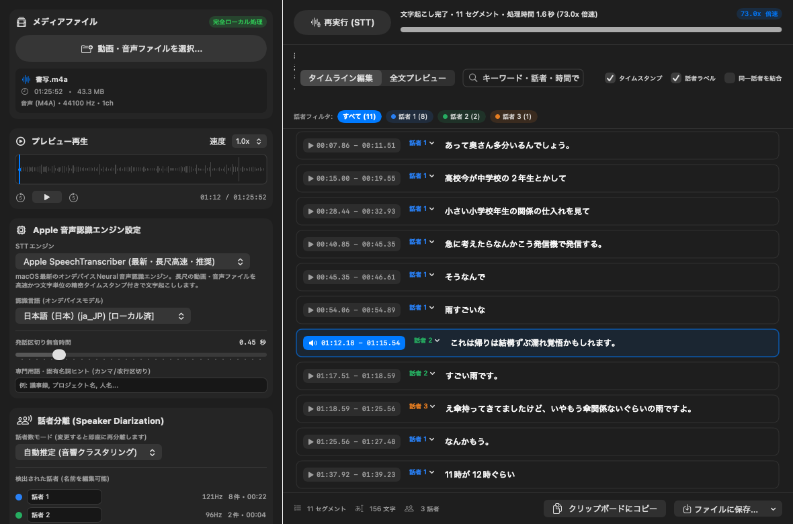

# LocalSpeechSTT (`LocalSpeechSTT.app`)

macOSネイティブ（SwiftUI + Apple `Speech` / `Accelerate` フレームワーク）で動作する、完全ローカル完結型の動画・音声文字起こし（STT）アプリケーションです。外部APIやクラウド通信を一切行わず、Appleオンデバイス音声認識エンジンを用いて高速に文字起こし・タイムスタンプ付与・話者分離を行います。



## 主な機能

1. **完全ローカル動作（Appleオンデバイス音声認識エンジン搭載）**
   - **Apple `SpeechTranscriber` (`SpeechAnalyzer`)**: macOS最新のオンデバイスNeural音声認識エンジン（長尺ファイル対応・数十倍速の高速処理・文字単位の精密タイムスタンプ）
   - **Apple `DictationTranscriber`**: ディクテーション特化オンデバイスモデル
   - **Apple `SFSpeechRecognizer`**: 従来型オンデバイス音声認識（自動チャンク分割により長尺ファイルにも対応）
2. **動画・音声ファイル両対応**
   - 対応形式: `MP4`, `MOV`, `M4V`, `M4A`, `MP3`, `WAV`, `AAC`, `FLAC`, `AIFF`, `CAF` 等
   - ファイル選択ダイアログ（`Cmd + O`）およびウィンドウへのドラッグ＆ドロップに対応
   - 動画プレビュー・音声波形シークバー・再生速度変更（`0.75x`〜`2.0x`）プレイヤー内蔵
3. **精密タイムスタンプ & インタラクティブ再生**
   - 文字レベルの `audioTimeRange` から発話単位の正確な開始・終了時刻（`[MM:SS.ms - MM:SS.ms]`）を算出
   - 各セグメントのタイムスタンプボタンをクリックすると、その位置から即座に再生
   - 再生位置に合わせて該当セグメントをリアルタイムハイライト＆自動スクロール
4. **ローカル話者分離（Speaker Diarization）**
   - Apple `Accelerate` (`vDSP`) フレームワークにより、各発話区間の基本周波数（Pitch $F_0$）・12次元MFCC・スペクトル重心・サブバンドエネルギー比を抽出し、教師なしクラスタリング（K-Means++ & シルエットスコア自動話者数推定）を実行
   - 話者数モード（`自動推定` / `2人` / `3人` / `4人` / `5人` / `6人` / `オフ`）を切り替えると、再文字起こし不要で**即座に再クラスタリング**
   - 話者名のカスタム変更（例: `話者 1` → `田中`）やセグメント個別の話者変更・本文インライン編集に対応
5. **多彩なエクスポート形式**
   - プレーンテキスト (`.txt`)、SubRip字幕 (`.srt`)、WebVTT字幕 (`.vtt`)、Markdown (`.md`)、JSON (`.json`)、CSV (`.csv`)
   - タイムスタンプ有無・話者ラベル有無・同一話者の連続発話結合の切り替えに対応

## 起動方法

Finderから `LocalSpeechSTT.app` をダブルクリックするか、ターミナルから以下を実行してください。

```zsh
open ./LocalSpeechSTT.app
```

起動時に特定の動画・音声ファイルを読み込ませることも可能です：

```zsh
./LocalSpeechSTT.app/Contents/MacOS/LocalSpeechSTT ./書写.m4a
```

## 再ビルド方法

ソースコード（`Sources/LocalSpeechSTT/`）を編集した場合は、以下のスクリプトで `LocalSpeechSTT.app` を再生成できます。

```zsh
./build_app.sh
```
