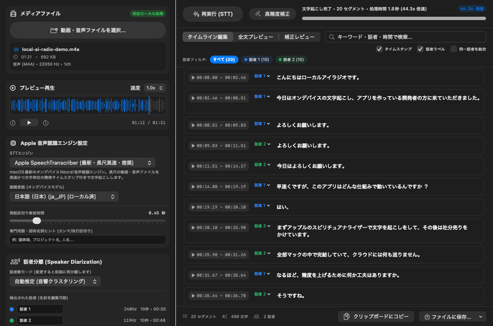
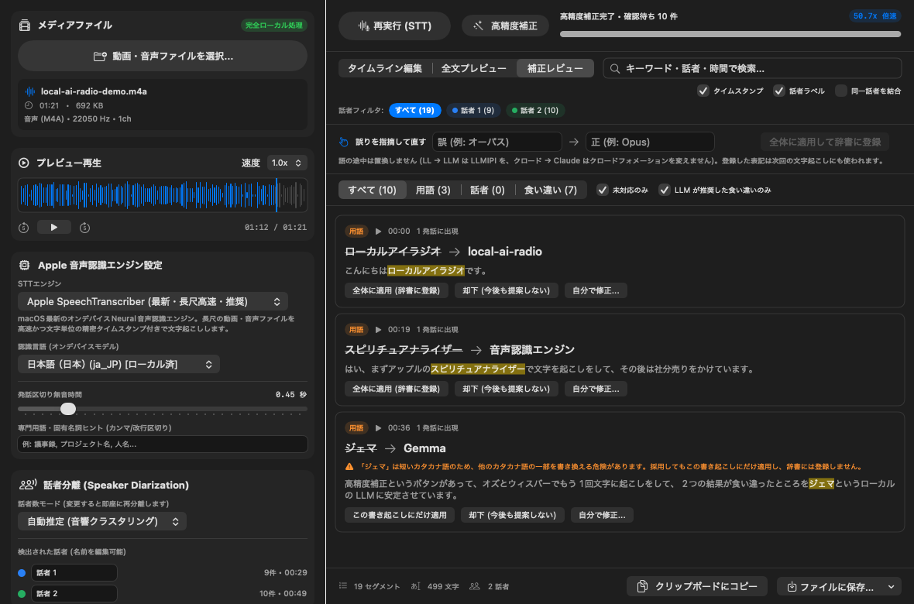

# LocalSpeechSTT (`LocalSpeechSTT.app`)

macOSネイティブ（SwiftUI + Apple `Speech` / `Accelerate` フレームワーク）で動作する、完全ローカル完結型の動画・音声文字起こし（STT）アプリケーションです。外部APIやクラウド通信を一切行わず、Appleオンデバイス音声認識エンジンを用いて高速に文字起こし・タイムスタンプ付与・話者分離を行います。





<sub>スクリーンショットの音声は、架空の台本を macOS の音声合成 (Kyoko / Otoya) で読み上げたデモです。</sub>

## 主な機能

1. **完全ローカル動作（Appleオンデバイス音声認識エンジン搭載）**
   - **Apple `SpeechTranscriber` (`SpeechAnalyzer`)**: macOS最新のオンデバイスNeural音声認識エンジン（長尺ファイル対応・数十倍速の高速処理・文字単位の精密タイムスタンプ）
   - **Apple `DictationTranscriber`**: ディクテーション特化オンデバイスモデル
   - **Apple `SFSpeechRecognizer`**: 従来型オンデバイス音声認識（自動チャンク分割により長尺ファイルにも対応）
2. **動画・音声ファイル両対応**
   - 対応形式: `MP4`, `MOV`, `M4V`, `M4A`, `MP3`, `WAV`, `AAC`, `FLAC`, `AIFF`, `CAF` 等
   - ファイル選択ダイアログ（`Cmd + O`）およびウィンドウへのドラッグ＆ドロップに対応
   - 動画プレビュー・音声波形シークバー・再生速度変更（`0.75x`〜`2.0x`）プレイヤー内蔵
3. **精密タイムスタンプ & インタラクティブ再生**
   - 文字レベルの `audioTimeRange` から発話単位の正確な開始・終了時刻（`[MM:SS.ms - MM:SS.ms]`）を算出
   - 各セグメントのタイムスタンプボタンをクリックすると、その位置から即座に再生
   - 再生位置に合わせて該当セグメントをリアルタイムハイライト＆自動スクロール
4. **ローカル話者分離（Speaker Diarization）**
   - 学習済みモデル不要・完全ローカルの古典的パイプラインを Apple `Accelerate` (`vDSP` / LAPACK) で実装
     1. ファイル全体から 10ms 単位の MFCC (19次元) を抽出（音声認識と並行して実行）
     2. 発話区間の全フレームでユニバーサル背景モデル (UBM, 32混合 GMM) を学習
     3. 約2秒の発話チャンクごとに MAP 適応した GMM スーパーベクトルを作り、コサイン類似度グラフをスペクトラルクラスタリング（`自動推定` は固有値ギャップで話者数を推定）
     4. 話者ごとの GMM 再推定 + Viterbi 再セグメンテーションを反復
     5. 認識トークン単位の Viterbi で話者を確定し、**1つの発話内で話者が交代した箇所でセグメントを分割**（句読点・ポーズでは交代しやすく、単語の途中では交代しにくい）
   - 話者数モード（`自動推定` / `2人` / `3人` / `4人` / `5人` / `6人` / `オフ`）を切り替えると、保持しているフレーム特徴量から再文字起こし不要で再分離
   - 話者名のカスタム変更（例: `話者 1` → `田中`）やセグメント個別の話者変更・本文インライン編集に対応
   - 数十秒程度の短い音声では自動推定が話者数を少なく見積もることがあります。その場合は話者数を明示的に指定してください
5. **高精度補正と補正レビュー（任意・完全ローカル）**
   - 文字起こし後に「高精度補正」を押すと、`tools/refine` の補正パイプラインを実行（46分の音声で約10分、初回はモデルのダウンロードあり）
     - Whisper large-v3-turbo (MLX) による2回目の文字起こしとの食い違い検出
     - ニューラル話者埋め込み (ERes2Net / sherpa-onnx) による話者の再判定
     - ローカル LLM (Gemma 4 E4B / MLX) による用語の誤表記候補の抽出と、食い違い箇所の判定
   - 「補正レビュー」タブで候補を1件ずつ **採用 / 却下 / 自分で修正** して確定（取り消し可）。候補に無い誤りは「誤 → 正」で直接指摘して全体に適用
   - 承認した表記は **用語辞書** に保存され、次回以降の文字起こしで認識ヒントとして使われ自動置換される。却下した候補は再提案されない
   - 必要なもの: `uv` と `ffmpeg`（ログインシェルの PATH から使用）。セットアップ: `cd tools/refine && uv sync`

6. **多彩なエクスポート形式**
   - プレーンテキスト (`.txt`)、SubRip字幕 (`.srt`)、WebVTT字幕 (`.vtt`)、Markdown (`.md`)、JSON (`.json`)、CSV (`.csv`)
   - タイムスタンプ有無・話者ラベル有無・同一話者の連続発話結合の切り替えに対応

## 起動方法

Finderから `LocalSpeechSTT.app` をダブルクリックするか、ターミナルから以下を実行してください。

```zsh
open ./LocalSpeechSTT.app
```

起動時に特定の動画・音声ファイルを読み込ませることも可能です：

```zsh
./LocalSpeechSTT.app/Contents/MacOS/LocalSpeechSTT ./書写.m4a
```

ヘッドレスでの検証用 CLI モード:

```zsh
# 文字起こし + 話者分離 (--speakers: 0=オフ, -1=自動, 2〜6=人数指定)
./LocalSpeechSTT.app/Contents/MacOS/LocalSpeechSTT --cli input.mp3 [--speakers 2] [--json-out segments.json]
# 保存済みセグメント (--speakers 0 で出力した JSON) に対して話者分離だけを再実行
./LocalSpeechSTT.app/Contents/MacOS/LocalSpeechSTT --diarize segments.json input.mp3 [--speakers 2]
```

## 再ビルド方法

ソースコード（`Sources/LocalSpeechSTT/`）を編集した場合は、以下のスクリプトで `LocalSpeechSTT.app` を再生成できます。

```zsh
./build_app.sh
```
